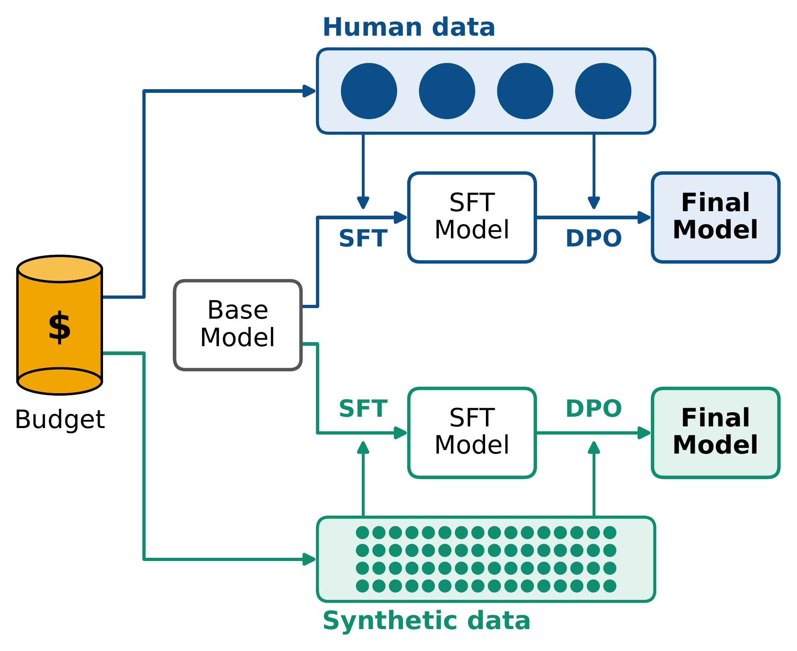

# Human or Synthetic? What a Fixed Budget Buys for Post-Training

Code for the paper Human or Synthetic? What a Fixed Budget Buys for Post-Training



Link - [ARXIV_URL](ARXIV_URL)

### Install

Training and response generation:

```bash
conda create --name tuning python=3.10
conda activate tuning
pip install -r requirements.txt
```

The LLM judges (gpt-oss-20b and Qwen) need a newer vLLM, so they run in a separate environment:

```bash
conda create --name judge python=3.12
conda activate judge
pip install -r requirements-judge.txt
```

Run every command from the repository root.

### Data

Training data goes in `tuning/datasets/`:

- `pt-<dataset>.jsonl`: preference pairs, one `{"chosen": ..., "rejected": ...}` per line, each a `Human: ... Assistant: ...` transcript.
- `sft-<dataset>.jsonl`: SFT examples, one `{"messages": [...]}` per line.

The synthetic datasets are on Hugging Face at [DATASET_REPO_ID](https://huggingface.co/datasets/DATASET_REPO_ID).

### Run

1. Supervised finetuning on `train_size` examples of a dataset:

```bash
bash tuning/scripts/train_sft.sh llama3-8B anthropic 769
```

2. DPO on top of the SFT model:

```bash
bash tuning/scripts/train_dpo.sh llama3-8B anthropic 769 --init_model tuning/models/llama3-8B_sft-anthropic-769
```

The base model is one of `llama3-8B`, `olmo3-7B` or `qwen2.5-7B`, and models are saved in `tuning/models/`.

3. Generate responses on the test set:

```bash
bash tuning/scripts/generate_responses.sh tuning/models/<run_name> llama3-8B tuning/datasets/anthropic_test.jsonl responses/<run_name>.jsonl
```

4. Judge the responses against the test set's reference responses (in the `judge` environment):

```bash
bash tuning/scripts/judge.sh helpfulness gptoss responses/<run_name>.jsonl tuning/datasets/anthropic_test.jsonl judge_results.jsonl raw/<run_name>.jsonl
```

`judge.sh` takes the task (`helpfulness` or `summarization`) and the judge (`gptoss` or `qwen`). Each run appends its win rate to `judge_results.jsonl`.

## Reference

If you find our work or code useful, please cite the paper:

```
BIBTEX
```
